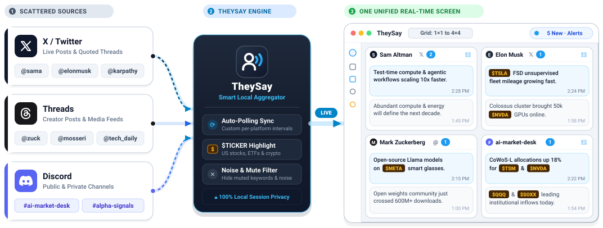
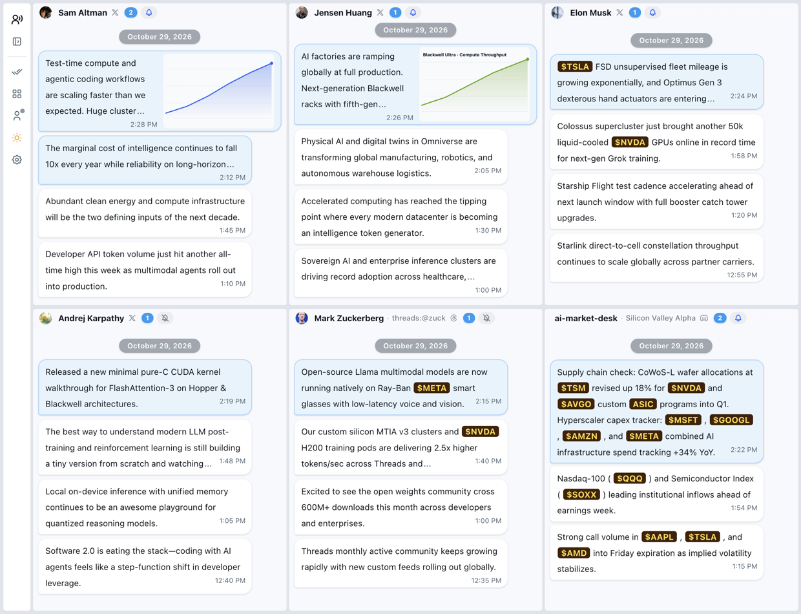

# TheySay — All the Voices on One Screen

[English](README.md) | [简体中文](docs/README_zh.md)

Stop jumping between endless browser tabs and apps. **TheySay** brings your favorite **X (Twitter)** accounts, **Threads** creators, and **Discord** channels together into a single, customizable desktop dashboard.

App screenshot:

## Download

Download the latest installer for **macOS**, **Windows**, or **Linux** from **[GitHub Releases](https://github.com/laike9m/TheySay/releases/latest)**.

## Highlights

- **One Screen for Every Account (`1×1` to `4×4` Layouts)**: Watch real-time updates from multiple followed accounts side by side in a single view. Choose any grid layout from `1×1` up to `4×4`, freely drag and resize cards to spotlight key feeds, and type any username to quickly add accounts across X and Threads—or paste a link to follow any public or private Discord channel.

- **Distraction-Free Chat-Style Reading**: Updates appear in clean, chronological chat bubbles instead of cluttered social media timelines. Web links automatically display readable page titles, images sit neatly beside the text, and clicking any message opens the full post, quoted thread, or high-resolution media in a focused popup reader.

- **Built for Market & Tech Watchers**: Automatically recognizes and highlights US stock, ETF, and crypto tickers (such as `$NVDA`, `$TSLA`, `$BTC`) with customizable badge colors so market-moving mentions stand out at a glance. Want less noise? Add mute keywords or phrases in Settings to hide unwanted topics automatically.

- **Never Miss an Update**: Unread counters on each card and on your system Dock / taskbar icon show exactly where new posts have arrived. Enable desktop notifications only for your highest-priority accounts while keeping the rest silent, or clear everything with a single click.

- **Personalized & Portable**: Switch effortlessly between Light and Dark themes, customize card and bubble colors, set independent auto-refresh intervals for each platform, receive automatic cross-platform version updates from GitHub Releases, and export or import your entire dashboard layout and followed list as a `.json` backup file anytime.

## Quick Start

On your first launch, an interactive spotlight guide (`driver.js`) walks you through signing in and showcases all three supported input formats right inside a single pop-up:

1. **Connect Your Accounts**: Use the left sidebar to sign in to X, Threads, or Discord (your session stays 100% local on your device).
2. **Set Up Your Grid**: Pick a layout from `1×1` to `4×4` in the sidebar, then click any card header to enter an `@handle` (`elonmusk`, `@OpenAI`), a Threads profile (`threads:@zuck`, `threads.com/@mosseri`), or a Discord channel link (`https://discord.com/channels/...`).
3. **Customize Your Workflow**: Click the bell icon on any card to toggle desktop notifications, or open **Settings** to adjust refresh intervals, ticker colors, language (`English` / `中文`), and keyword filters.

## License

Licensed under the **[PolyForm Noncommercial License 1.0.0](LICENSE)**.
