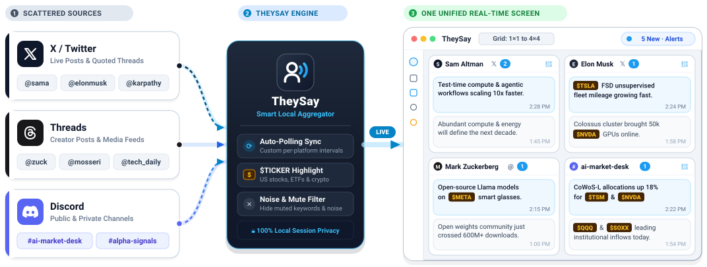
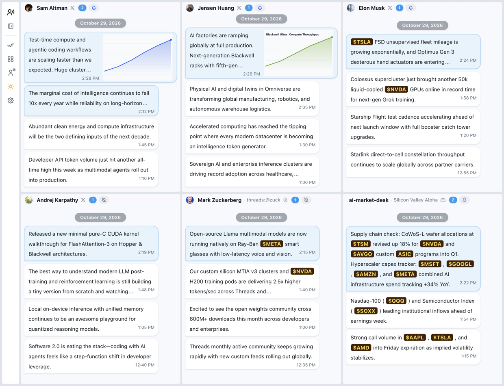

# TheySay — すべての声を 1 つの画面に

[English](../README.md) | [简体中文](README_zh.md) | [日本語](README_ja.md)

無数のブラウザタブやアプリを行き来するのはもうやめましょう。**TheySay** は、お気に入りの **X (Twitter)** アカウント、**Threads** のクリエイター、**Discord** のチャンネルを、カスタマイズ可能な 1 つのデスクトップダッシュボードにまとめます。

アプリのスクリーンショット：

## ダウンロード

**macOS**、**Windows**、**Linux** 向けの最新インストーラーは **[GitHub Releases](https://github.com/laike9m/TheySay/releases/latest)** からダウンロードできます。

## 主な特長

- **すべてのアカウントを 1 つの画面に（`1×1` から `4×4` のレイアウト）**: フォローしている複数のアカウントのリアルタイムの更新を、1 つのビューに並べて確認できます。`1×1` から `4×4` まで好きなグリッドレイアウトを選び、カードを自由にドラッグ・リサイズして重要なフィードを目立たせられます。ユーザー名を入力するだけで X や Threads のアカウントをすばやく追加でき、リンクを貼り付ければ公開・非公開を問わず Discord のチャンネルもフォローできます。

- **気が散らないチャット形式の閲覧**: 更新は、ごちゃごちゃした SNS のタイムラインではなく、時系列に並んだすっきりとしたチャットバブルで表示されます。Web リンクには読みやすいページタイトルが自動で表示され、画像はテキストの横にきれいに並びます。メッセージをクリックすると、投稿全体、引用されたスレッド、高解像度のメディアを、集中して読めるポップアップリーダーで開けます。

- **マーケットやテックの動向を追う人のために**: 米国株、ETF、暗号資産のティッカー（`$NVDA`、`$TSLA`、`$BTC` など）を自動で認識し、カスタマイズ可能なバッジの色でハイライトするので、相場を動かす言及がひと目でわかります。ノイズを減らしたい場合は、設定でミュートするキーワードやフレーズを追加すれば、不要な話題を自動で非表示にできます。

- **更新を見逃さない**: 各カードとシステムの Dock / タスクバーのアイコンに表示される未読カウンターで、新しい投稿が届いた場所が正確にわかります。最優先のアカウントだけデスクトップ通知を有効にしてほかは静かにしておくことも、ワンクリックですべてを既読にすることもできます。

- **自分好みに、持ち運びも自在に**: ライトテーマとダークテーマを簡単に切り替え、カードやバブルの色をカスタマイズし、プラットフォームごとに独立した自動更新の間隔を設定できます。GitHub Releases からクロスプラットフォームのバージョン更新を自動で受け取れるほか、ダッシュボードのレイアウトとフォローリスト全体を `.json` のバックアップファイルとしていつでもエクスポート・インポートできます。

## クイックスタート

初回起動時には、インタラクティブなスポットライトガイド（`driver.js`）がサインインの手順を案内し、対応している 3 つの入力形式を 1 つのポップアップ内で紹介します。

1. **アカウントを接続する**: 左のサイドバーから X、Threads、Discord にサインインします（セッションは 100% お使いのデバイス内に保存されます）。
2. **グリッドを設定する**: サイドバーで `1×1` から `4×4` までのレイアウトを選び、任意のカードのヘッダーをクリックして、`@handle`（`elonmusk`、`@OpenAI`）、Threads のプロフィール（`threads:@zuck`、`threads.com/@mosseri`）、または Discord のチャンネルリンク（`https://discord.com/channels/...`）を入力します。
3. **ワークフローをカスタマイズする**: 任意のカードのベルアイコンをクリックしてデスクトップ通知を切り替えるか、**Settings** を開いて更新間隔、ティッカーの色、言語（`English` / `中文`）、キーワードフィルターを調整します。

## ライセンス

**[PolyForm Noncommercial License 1.0.0](../LICENSE)** の下でライセンスされています。
