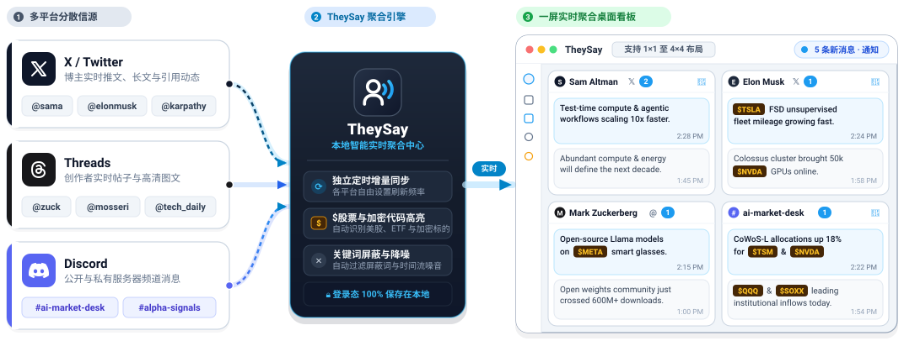
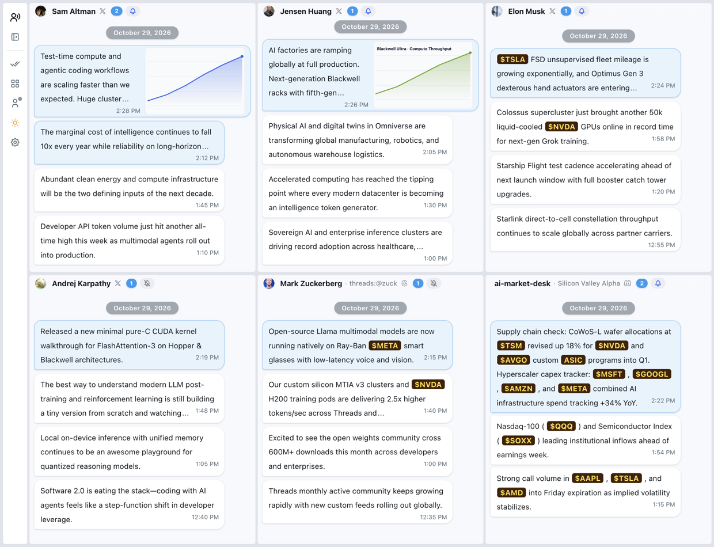

# TheySay — 在一个界面，实时追踪所有声音

[English](../README.md) | [简体中文](README_zh.md) | [日本語](README_ja.md)

告别在无数浏览器标签页与软件之间来回切换。**TheySay** 将你关注的 **X (Twitter)** 博主、**Threads** 创作者与 **Discord** 频道汇聚在同一块桌面看板上，重要动态一目了然。

App 界面：

## 下载安装

前往 **[GitHub Releases](https://github.com/laike9m/TheySay/releases/latest)** 下载适用于 **macOS**、**Windows** 或 **Linux** 的最新安装包。

## 核心亮点

- **一屏纵览多账号动态（支持 `1×1` 至 `4×4` 布局）**：在一个界面内同时查看多个关注账号的实时更新。支持从 `1×1` 到 `4×4` 的灵活网格布局，卡片可自由拖拽与调整大小；直接输入用户名即可添加 X 或 Threads 账号，粘贴链接即可追踪任意公开或私有 Discord 频道。

- **清爽的对话流阅读体验**：告别杂乱的信息流广告与算法干扰，所有动态均以清爽的时间流对话气泡呈现。网页链接自动显示文章标题，配图与文字紧凑排布；点击任意气泡即可弹出阅读卡片，随时查看完整长文、引用内容或高清大图。

- **为市场与科技追踪打造**：自动识别并高亮消息中的美股、ETF 与加密货币代码（如 `$NVDA`、`$TSLA`、`$BTC`），支持自定义高亮配色，让你一眼捕捉关键标的；同时支持在设置中添加屏蔽词或短语，自动过滤噪音信息。

- **重要消息不再遗漏**：每张卡片与系统 Dock / 任务栏图标均会实时显示未读消息数量。你可以只为最核心的账号开启桌面弹窗通知、将其他频道保持静默，也可以随时一键全部标为已读。

- **个性化外观与一键备份**：支持浅色与深色模式一键切换，可自由定制卡片背景与气泡配色，并为不同平台单独设置自动刷新频率；支持基于 GitHub Releases 的全平台自动版本检测与一键更新，并可将所有关注列表、排版与偏好设置一键导出为 `.json` 文件，跨设备迁移轻而易举。

## 快速上手

首次打开应用时，内置的聚光灯引导动画（基于 `driver.js`）会自动带你认识左侧登录入口，并在同一弹窗中直观展示三种平台的输入格式：

1. **登录平台账号**：在左侧边栏点击对应图标登录 X、Threads 或 Discord（登录状态 100% 保存在本地设备）。
2. **配置监控面板**：在左侧切换 `1×1` 至 `4×4` 网格布局，点击任意卡片顶部输入 Twitter 用户名（如 `elonmusk`、`@OpenAI`）、Threads 账号（如 `threads:@zuck`、`threads.com/@mosseri`）或粘贴 Discord 频道链接。
3. **定制专属工作流**：点击卡片右上角铃铛图标单独开启桌面通知，或打开 **设置** 调整刷新频率、股票代码配色、界面语言（`中文` / `English`）与屏蔽词。

## 许可协议

本项目采用 **[PolyForm Noncommercial License 1.0.0](../LICENSE)** 许可协议。
